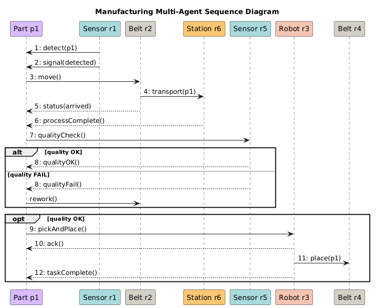

# Agent Interaction Design

A UML sequence diagram of one part (p1) moving through a manufacturing cell. Each component is modelled as an agent: a sensor, belts, a processing station, a quality sensor and a robot.

1. **Detection and transport.** Sensor r1 detects the part, and belt r2 carries it to station r6 for processing.
2. **Quality check.** Sensor r5 inspects the part. The `alt` block shows the two outcomes: *quality OK*, or *quality FAIL*, which sends the part back to the belt for rework.
3. **Hand-off.** If the part passed (`opt` block), robot r3 picks it and places it on belt r4, then confirms the task is complete.

The part itself drives the flow by requesting services from the resources. That is the same part-centric idea used in the CMAS final project.
